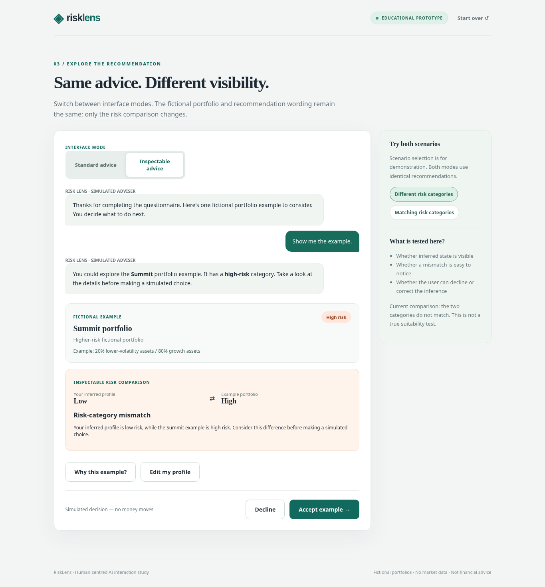
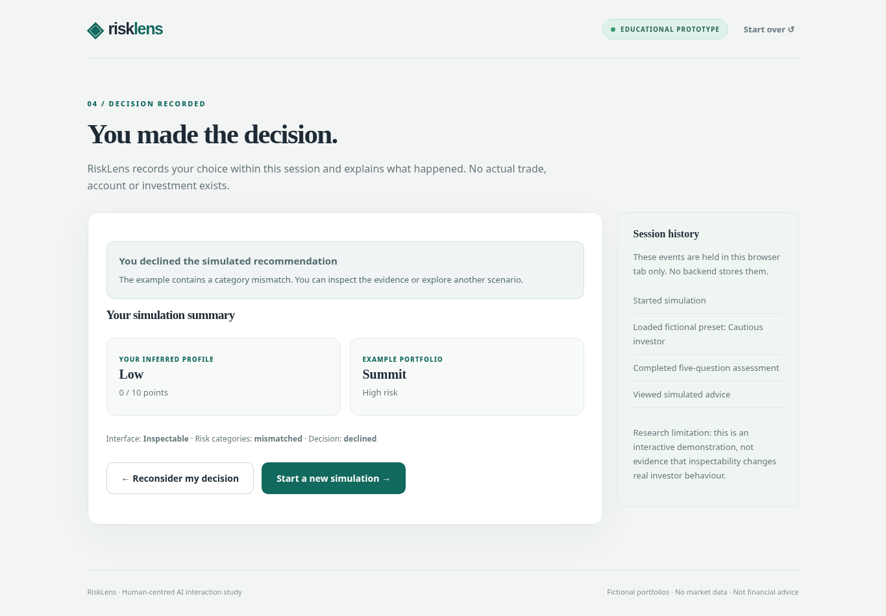
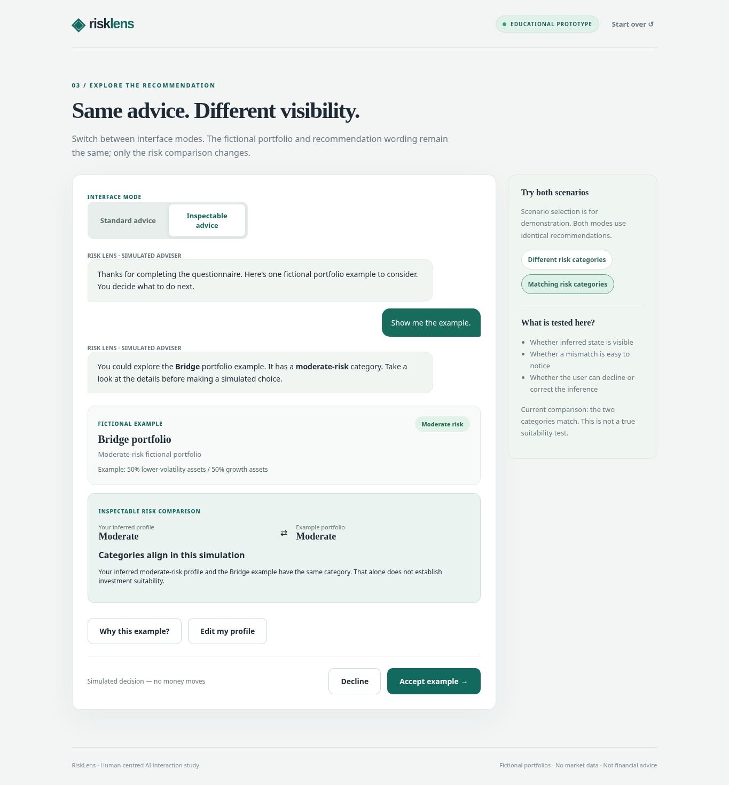
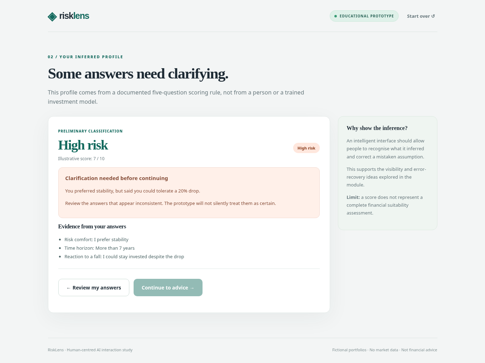

# RiskLens interaction storyboards

These are **storyboard descriptions of real prototype states**. The linked screenshots were captured by an automated Chromium browser-state walkthrough using the same HTML, CSS and JavaScript files as the project. They are implementation evidence, **not** participant observations or evidence of increased investment judgement.

**Screenshot provenance:** All existing screenshots show v0.1 before the scenario-selector update in `613ff7b`. The journeys below remain valid, but current advice screens use descriptive scenario radio cards with portfolio/risk labels and selection feedback. No new screenshots or participant observations are claimed.

## Storyboard A — Notice a mismatch and decline

1. **User action:** Start simulation → choose the *Cautious* preset → answer through the five questions.
2. **System inference:** Rule-based score 0/10 → *Low risk*; state and source answers shown.
3. **User action:** Continue → set *Different risk categories — Summit portfolio · High risk* → select *Inspectable advice*.
4. **System output:** Fictional *Summit* example (High risk) appears with an explicit Low ↔ High comparison and mismatch feedback.
5. **User action:** Select *Decline*.
6. **System response/control:** Decision summary records the decline; user may reconsider, then revise their answers from the advice screen, or reset. No money moves.

## Storyboard B — Aligned advice and acceptance

1. **User action:** Start → choose *Balanced* preset → proceed to profile.
2. **System inference:** 5/10 → *Moderate risk*; evidence list is visible.
3. **User action:** Continue → choose *Matching risk categories — Bridge portfolio · Moderate risk* → select *Inspectable advice*.
4. **System output:** Fictional *Bridge* example (Moderate risk) matches the inferred category; the screen explicitly warns that a match is not a real suitability assessment.
5. **User action:** Select *Accept example*.
6. **System response/control:** Neutral session summary records the fictional acceptance, never a real trade. Reconsider is available.

## Storyboard C — Clarify contradictory preferences

1. **User action:** Start → choose *Conflicting* preset → proceed through the populated questionnaire.
2. **System inference:** Answers conflict: prefers stability but would tolerate a large drop.
3. **System output:** Preliminary risk label and an explicit *Clarification needed* message; continuing to advice is disabled.
4. **User action:** Select *Review my answers*, change loss tolerance to the cautious option, then complete the questions.
5. **System response/control:** The updated score is 5/10 (Moderate risk); the contradiction clears and the user can continue.

**Boundary:** all portfolios and scoring thresholds are deliberately simplified; no predictive model, financial-data provider, brokerage integration or user study has been implemented.
