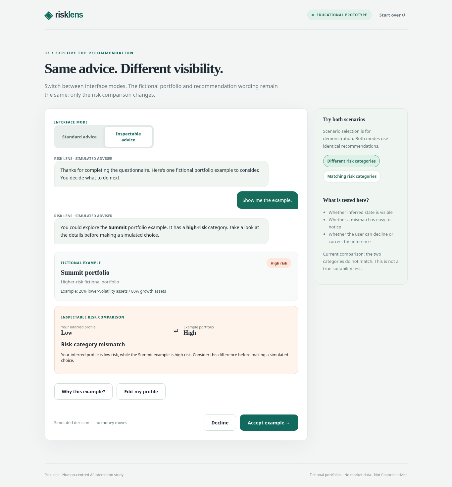
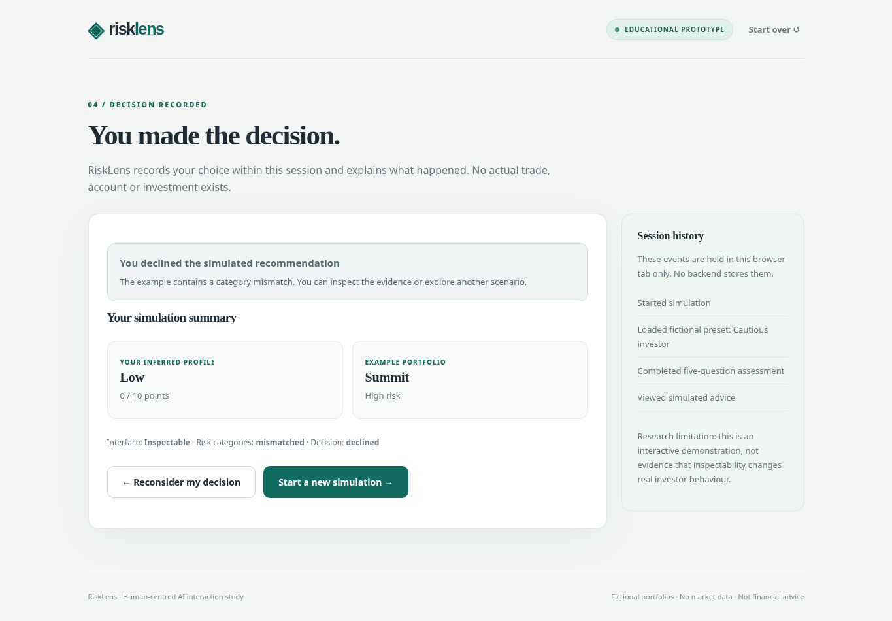
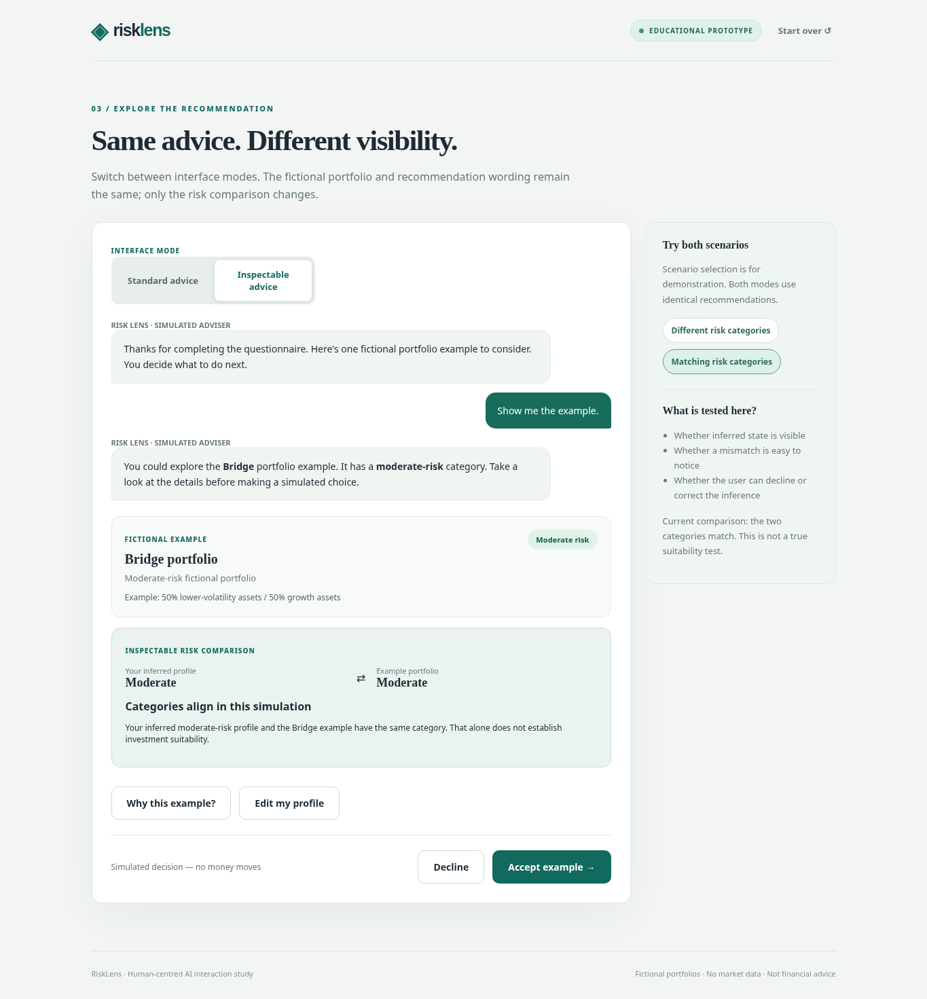
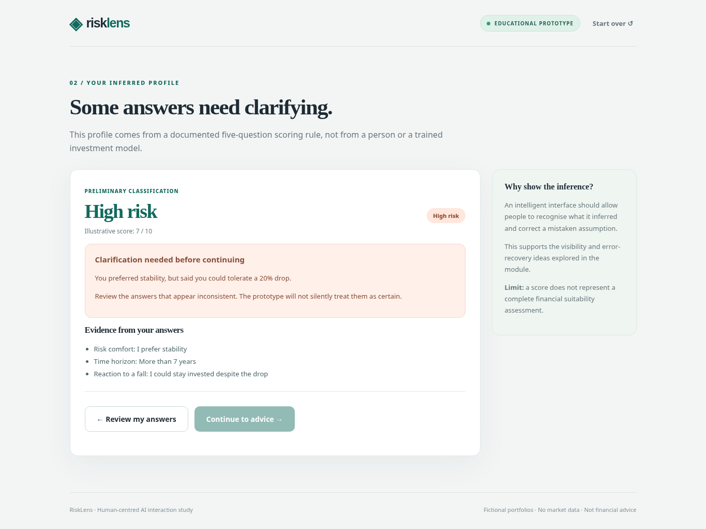
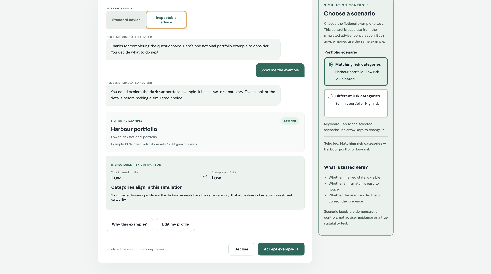

# RiskLens interaction storyboards

These are **storyboard descriptions of real prototype states**. The linked screenshots were captured by an automated Chromium browser-state walkthrough using the same HTML, CSS and JavaScript files as the project. They are implementation evidence, **not** participant observations or evidence of increased investment judgement.

**Screenshot provenance:** All existing screenshots show v0.1 before the scenario-selector update in `613ff7b`. The journeys below remain valid, but current advice screens use descriptive scenario radio cards with portfolio/risk labels and selection feedback. No new screenshots or participant observations are claimed.

## Storyboard A — Notice a mismatch and decline

1. **User action:** Start simulation → choose the _Cautious_ preset → answer through the five questions.
2. **System inference:** Rule-based score 0/10 → _Low risk_; state and source answers shown.
3. **User action:** Continue → set _Different risk categories — Summit portfolio · High risk_ → select _Inspectable advice_.
4. **System output:** Fictional _Summit_ example (High risk) appears with an explicit Low ↔ High comparison and mismatch feedback.
5. **User action:** Select _Decline_.
6. **System response/control:** Decision summary records the decline; user may reconsider, then revise their answers from the advice screen, or reset. No money moves.

## Storyboard B — Aligned advice and acceptance

1. **User action:** Start → choose _Balanced_ preset → proceed to profile.
2. **System inference:** 5/10 → _Moderate risk_; evidence list is visible.
3. **User action:** Continue → choose _Matching risk categories — Bridge portfolio · Moderate risk_ → select _Inspectable advice_.
4. **System output:** Fictional _Bridge_ example (Moderate risk) matches the inferred category; the screen explicitly warns that a match is not a real suitability assessment.
5. **User action:** Select _Accept example_.
6. **System response/control:** Neutral session summary records the fictional acceptance, never a real trade. Reconsider is available.

## Storyboard C — Clarify contradictory preferences

1. **User action:** Start → choose _Conflicting_ preset → proceed through the populated questionnaire.
2. **System inference:** Answers conflict: prefers stability but would tolerate a large drop.
3. **System output:** Preliminary risk label and an explicit _Clarification needed_ message; continuing to advice is disabled.
4. **User action:** Select _Review my answers_, change loss tolerance to the cautious option, then complete the questions.
5. **System response/control:** The updated score is 5/10 (Moderate risk); the contradiction clears and the user can continue.

**Boundary:** all portfolios and scoring thresholds are deliberately simplified; no predictive model, financial-data provider, brokerage integration or user study has been implemented.

Scroll to the bottom and paste this:

## Updated interface — usability improvement

During manual testing, I found that the original scenario-selection controls were not immediately obvious. I improved the interface by introducing clearly labelled radio cards, visible selection feedback and a separate simulation-controls panel.

The screenshot below shows the revised interface with the matching Harbour portfolio selected and the inspectable Low risk ↔ Low risk comparison visible.

This change is documented in commit [613ff7b](https://github.com/almarej/risklens-robo-adviser/commit/613ff7b).
